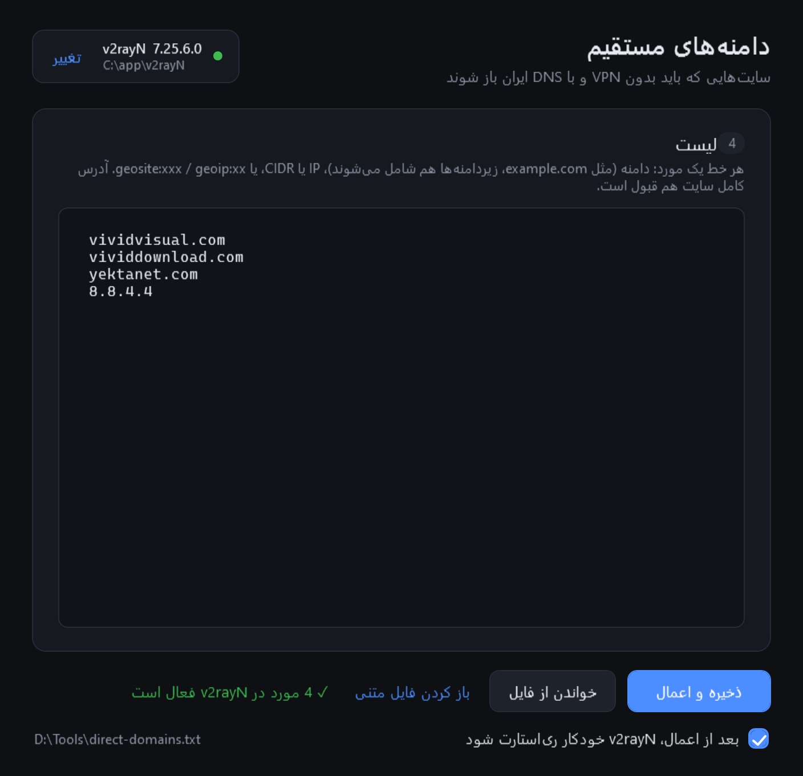

# v2rayN Direct Domains

ابزار گرافیکی تک‌فایل برای اینکه سایت‌های دلخواه شما در v2rayN **مستقیم (بدون VPN) و با DNS ایران** باز شوند.
A single-file Windows GUI tool that makes your chosen sites bypass the VPN in v2rayN and resolve through your Iran DNS.

## چرا لازم است / Why
Iran rules (`geosite:ir`) cover ~57k domains, but not every Iranian site (many are not `.ir`, or sit behind foreign CDNs). With a DNS that only accepts Iranian IPs (`expectedIPs: geoip:ir`), such sites can even **fail to resolve**. This tool fixes both routing and DNS for the domains you list.

## امکانات / Features
- One entry per line: domain (subdomains included), full URL, IP / CIDR, IDN (Persian) domain, `geosite:xxx`, `geoip:xx`. `#` starts a comment.
- Adds a **direct** rule at the top of every routing profile (`My Direct`, `My Direct IP`)
- Adds a DNS server (your existing Iran DNS, no `expectedIPs` filter) for those domains, tagged `my-direct`, in both Normal and TUN DNS
- **Backup in a text file** next to the `.bat` (`direct-domains.txt`): after you reset v2rayN, run the tool again and re-apply with one click
- Idempotent (apply as many times as you like), a backup of `guiNDB.db` before each change, optional automatic v2rayN restart
- Works with v2rayN 6.x / 7.x. No install, no Python (PowerShell/WPF + v2rayN's own `e_sqlite3.dll`)

## استفاده / Usage
Double-click `v2rayN-Direct-Domains.bat`, accept UAC. It looks in `C:\app` first, then other places (**تغییر** to pick another v2rayN). Type your domains, press **ذخیره و اعمال**.

## Notes
- Nothing is sent anywhere; everything stays on your PC.
- Pairs well with [v2rayn-reset-setup](https://github.com/saateon/v2rayn-reset-setup) and [ssh-to-v2rayn](https://github.com/saateon/ssh-to-v2rayn).

## License
MIT